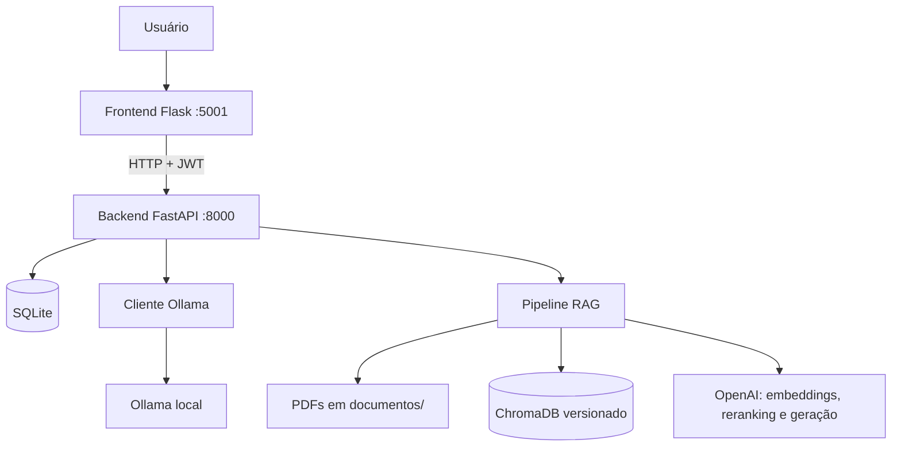

# Documentação Técnica — QA AI Platform

## 1. Visão geral

O **QA AI Platform** é uma aplicação web de perguntas e respostas com duas
modalidades de IA:

- **chat generalista**, atendido por um modelo LLM local executado no Ollama;
- **consulta RAG**, que responde com base em documentos PDF locais, usando
  ChromaDB para recuperação semântica e OpenAI para embeddings, reranking e
  geração final.

A solução é composta por um frontend Flask e um backend FastAPI. O backend
concentra autenticação, persistência, integração com IA e indexação documental;
o frontend fornece as telas de registro, login, dashboard de chat e consulta
RAG.

## 2. Documentos relacionados

| Documento | Conteúdo |
| --- | --- |
| [README.md](README.md) | Instalação, configuração e execução local. |
| [docs/requisitos.md](docs/requisitos.md) | Requisitos funcionais e não funcionais, critérios de aceite e limites conhecidos. |
| [docs/endpoints.md](docs/endpoints.md) | Referência de endpoints, autenticação e exemplos de consumo. |

## 3. Escopo funcional

| Área | Capacidades principais |
| --- | --- |
| Usuários | Registro com confirmação de senha, login por nome ou e-mail e perfil autenticado. |
| Segurança | Senhas protegidas com bcrypt e acesso às rotas privadas por JWT Bearer. |
| Chat | Perguntas ao modelo Ollama, resposta completa ou streaming SSE e histórico por usuário. |
| RAG | Listagem de PDFs, busca vetorial, reranking, geração contextual e fontes retornadas ao usuário. |
| Persistência | SQLite para usuários/conversas/auditoria RAG e ChromaDB para índice vetorial. |
| Operação | Scripts para validar dependências, iniciar e parar os serviços locais. |

## 4. Arquitetura



### 4.1 Componentes

| Camada | Tecnologia | Responsabilidade |
| --- | --- | --- |
| Interface | Flask, Bootstrap 5 e JavaScript | Páginas, formulários, dashboard, chat e RAG. |
| API | FastAPI, Pydantic e SQLAlchemy | Contratos HTTP, validação, autenticação, persistência e integração de IA. |
| Chat | HTTPX e Ollama | Comunicação com `/api/generate`, com suporte a streaming. |
| RAG | LangChain, LangChain OpenAI e LangChain Chroma | Carga de PDFs, fragmentação, embeddings, busca, reranking e geração. |
| Dados relacionais | SQLite | Usuários, conversas e logs de consultas RAG. |
| Dados vetoriais | ChromaDB | Vetores dos fragmentos de PDFs e busca por similaridade. |

## 5. Fluxos principais

### 5.1 Registro e autenticação

1. O usuário preenche nome, e-mail, senha e confirmação de senha.
2. O frontend impede o envio enquanto as senhas forem diferentes.
3. O backend valida os dados, cria hash bcrypt e persiste o usuário.
4. O login recebe nome ou e-mail mais senha e retorna um JWT com expiração
   configurável.
5. Rotas privadas recebem o token pelo cabeçalho `Authorization: Bearer`.

### 5.2 Chat Ollama

1. O dashboard envia `prompt`, contexto opcional e preferência de streaming ao
   endpoint `POST /api/v1/chat/ask`.
2. O backend envia a solicitação ao Ollama local configurado.
3. A resposta é retornada integralmente ou como eventos SSE.
4. Ao final, prompt, resposta, modelo e estimativa de tokens são persistidos
   para o usuário autenticado.

### 5.3 Consulta RAG

1. O usuário autenticado envia uma pergunta a `POST /api/v1/rag/query`.
2. O ChromaDB recupera os oito fragmentos semanticamente mais próximos.
3. O modelo de RAG reclassifica a relevância dos trechos.
4. Os quatro fragmentos melhor classificados compõem o contexto da geração.
5. A API devolve resposta, arquivo de origem, categoria e trecho recuperado.
6. Pergunta, resposta e fontes são registradas para auditoria.

> A consulta RAG usa serviços OpenAI. Perguntas e trechos relevantes dos PDFs
> deixam o ambiente local durante embeddings, reranking e geração final.

## 6. Índice RAG persistente e recuperável

O índice não é mais apagado em toda inicialização. O backend cria um manifesto
com nome, tamanho, data de modificação e hash dos PDFs, além do modelo de
embeddings e dos parâmetros de fragmentação.

1. Se o manifesto atual for igual ao persistido, o índice Chroma existente é
   aberto e reutilizado, sem nova geração de embeddings.
2. Se houver mudança, o novo índice é construído em uma versão separada dentro
   de `backend/chroma_rh_versions/`.
3. A versão é validada antes da ativação.
4. `backend/chroma_rh/` atua como apontador para a versão ativa.
5. Um lock de arquivo evita reindexações simultâneas.
6. Se a reconstrução falhar, a versão anterior permanece disponível e é
   reutilizada em memória.

Esse desenho reduz custo de embeddings, diminui o tempo de startup e evita que
uma falha deixe a aplicação sem base vetorial válida.

## 7. Configuração

As configurações são lidas de `.env`, arquivo que não deve ser versionado.

| Grupo | Variáveis |
| --- | --- |
| Backend | `BACKEND_HOST`, `BACKEND_PORT`, `DATABASE_URL` |
| Autenticação | `JWT_SECRET_KEY`, `JWT_ALGORITHM`, `ACCESS_TOKEN_EXPIRE_MINUTES` |
| Ollama | `OLLAMA_BASE_URL`, `OLLAMA_MODEL`, `OLLAMA_MAX_TOKENS`, `OLLAMA_TIMEOUT_SECONDS` |
| RAG/OpenAI | `OPENAI_API_KEY`, `EMBEDDING_MODEL`, `LLM_MODEL_RAG` |
| Frontend | `FRONTEND_HOST`, `FRONTEND_PORT`, `API_BASE_URL` |

O diretório do SQLite é criado antes da abertura da conexão. Se a inicialização
do banco falhar, o backend não é publicado em estado parcialmente inicializado.

## 8. Operação local

### 8.1 Inicialização

```bash
./scripts/start_services.sh
```

O script valida esta sequência:

1. disponibilidade do Ollama;
2. presença do modelo configurado;
3. disponibilidade ou inicialização do backend;
4. disponibilidade ou inicialização do frontend.

Os logs de inicialização ficam em `logs/backend-startup.log` e
`logs/frontend-startup.log` quando os serviços são iniciados pelo script.

### 8.2 Encerramento

```bash
./scripts/stop_services.sh
```

O script identifica processos compatíveis nas portas 8000 e 5001, envia
`SIGTERM`, aguarda encerramento e usa `SIGKILL` apenas como último recurso.

## 9. Observabilidade e testes

O backend registra eventos de inicialização, requisições, respostas, banco,
modelos e RAG em `logs/backend.log`, sem registrar senhas, hashes bcrypt ou
tokens.

Os testes ficam em `backend/tests/` e usam SQLite em memória. O ciclo de vida
do RAG é mockado nos testes de endpoints, evitando chamadas externas e disputa
do índice local. Há também testes unitários para:

- ausência de vazamento de senha em saída padrão/erro;
- preparação do diretório SQLite e startup fail-fast do banco;
- manifesto RAG, reutilização de índice e fallback para a versão anterior.

Execute a suíte com:

```bash
python3 -m pytest backend/tests -q
```

## 10. Endpoints

As rotas estão sob o prefixo `/api/v1` e são documentadas automaticamente em:

- `http://127.0.0.1:8000/docs`
- `http://127.0.0.1:8000/api/v1/openapi.json`

Consulte [docs/endpoints.md](docs/endpoints.md) para exemplos completos de
autenticação, chat, streaming, histórico, RAG e saúde.

## 11. Restrições e evolução recomendada

- A implementação de lock e apontador de índice usa `fcntl` e symlinks; o
  ambiente alvo atual é macOS/Linux.
- O endpoint público de saúde confirma a resposta do backend, mas não valida de
  forma independente a disponibilidade do Ollama, OpenAI ou a integridade do
  índice RAG.
- As fontes RAG expõem documento, categoria e trecho; página do PDF não faz
  parte do contrato atual.
- Antes de uma publicação externa, a política CORS deve ser restrita por
  ambiente e todo Markdown/conteúdo proveniente do modelo deve ser sanitizado
  para reduzir risco de XSS.
